  

  <b>Web apps &nbsp;·&nbsp; Automations &nbsp;·&nbsp; API integrations</b>

  I turn ideas into useful web apps and connect tools to make everyday work simpler.

---

### A little about me

- I build web applications with **Bubble** and custom integrations.
- I enjoy turning repetitive tasks into **automated workflows**.
- I work with **APIs, payments, and messaging** to connect the pieces.
- I care about clear interfaces and the small details that make a product easier to use.

### Things I like building

| Web applications | Workflow automation | Connected products |
| :--- | :--- | :--- |
| Dashboards, tools, and useful product features. | Fewer manual steps and smoother day-to-day processes. | APIs, webhooks, payments, and messaging working together. |

### My toolbox

  

---

  <b>Good ideas deserve to become useful things.</b> 
  Build. Connect. Improve.

