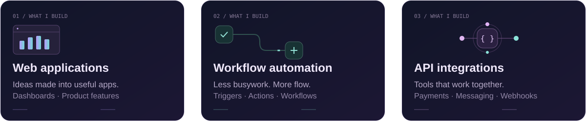

  

  <b>A curious mind, a practical builder, and a little love for the night sky.</b> 
  I build web apps and connect tools to make everyday work simpler.

  <a href="https://github.com/raza-musavi?tab=repositories">Explore my repositories</a>
  &nbsp; / &nbsp;
  <a href="https://www.linkedin.com/in/razamusavi">Connect on LinkedIn</a>

### Turning ideas into working products

  

### A little about me

I work with **Bubble**, **APIs**, and **automated workflows** to turn ideas into useful features. I enjoy connecting payments, messaging, and webhooks, and I care about the details that make a product feel simple to use.

  

Somewhere between a good idea and its next iteration. ☾

