<!-- Local SVG artwork supports light/dark themes, mobile layouts, and reduced motion. -->

<picture>
  <source media="(max-width: 600px) and (prefers-color-scheme: dark)" srcset="./assets/banner-mobile.svg" />
  <source media="(max-width: 600px)" srcset="./assets/banner-mobile-light.svg" />
  <source media="(prefers-color-scheme: dark)" srcset="./assets/banner.svg" />
  
</picture>

  
  

## A little about me

I'm Reza, a curious mind and a practical builder. I build web apps and connect tools to make everyday work simpler. I enjoy turning an idea into something people can actually use, then making the details better with each iteration.

## What I build

<picture>
  <source media="(max-width: 600px) and (prefers-color-scheme: dark)" srcset="./assets/workbench-mobile.svg" />
  <source media="(max-width: 600px)" srcset="./assets/workbench-mobile-light.svg" />
  <source media="(prefers-color-scheme: dark)" srcset="./assets/workbench.svg" />
  
</picture>

## On GitHub

<picture>
  <source media="(max-width: 600px) and (prefers-color-scheme: dark)" srcset="https://github-stats-extended.vercel.app/api?username=raza-musavi&amp;card_width=420&amp;hide_border=false&amp;border_radius=16&amp;bg_color=151B2A&amp;border_color=35364E&amp;title_color=C4B5FD&amp;text_color=BBC1D3&amp;icon_color=7DE4D2&amp;show_icons=true&amp;rank_icon=github&amp;disable_animations=true&amp;custom_title=GitHub+at+a+glance" />
  <source media="(max-width: 600px)" srcset="https://github-stats-extended.vercel.app/api?username=raza-musavi&amp;card_width=420&amp;hide_border=false&amp;border_radius=16&amp;bg_color=FFFFFF&amp;border_color=DCD9ED&amp;title_color=6D28D9&amp;text_color=555D77&amp;icon_color=0F766E&amp;show_icons=true&amp;rank_icon=github&amp;disable_animations=true&amp;custom_title=GitHub+at+a+glance" />
  <source media="(prefers-color-scheme: dark)" srcset="https://github-stats-extended.vercel.app/api?username=raza-musavi&amp;card_width=600&amp;hide_border=false&amp;border_radius=16&amp;bg_color=151B2A&amp;border_color=35364E&amp;title_color=C4B5FD&amp;text_color=BBC1D3&amp;icon_color=7DE4D2&amp;show_icons=true&amp;rank_icon=github&amp;disable_animations=true&amp;custom_title=GitHub+at+a+glance" />
  
</picture>

<b>Contribution streak &amp; language breakdown</b>

 

<picture>
  <source media="(max-width: 600px) and (prefers-color-scheme: dark)" srcset="https://streak-stats.demolab.com/?user=raza-musavi&amp;timezone=Asia%2FKarachi&amp;card_width=420&amp;hide_border=false&amp;border_radius=16&amp;background=151B2A&amp;border=35364E&amp;ring=C4B5FD&amp;fire=7DE4D2&amp;currStreakLabel=C4B5FD&amp;sideLabels=BBC1D3&amp;currStreakNum=F3F2FF&amp;sideNums=F3F2FF&amp;dates=BBC1D3&amp;stroke=35364E" />
  <source media="(max-width: 600px)" srcset="https://streak-stats.demolab.com/?user=raza-musavi&amp;timezone=Asia%2FKarachi&amp;card_width=420&amp;hide_border=false&amp;border_radius=16&amp;background=FFFFFF&amp;border=DCD9ED&amp;ring=6D28D9&amp;fire=0F766E&amp;currStreakLabel=6D28D9&amp;sideLabels=555D77&amp;currStreakNum=22233B&amp;sideNums=22233B&amp;dates=555D77&amp;stroke=DCD9ED" />
  <source media="(prefers-color-scheme: dark)" srcset="https://streak-stats.demolab.com/?user=raza-musavi&amp;timezone=Asia%2FKarachi&amp;card_width=600&amp;hide_border=false&amp;border_radius=16&amp;background=151B2A&amp;border=35364E&amp;ring=C4B5FD&amp;fire=7DE4D2&amp;currStreakLabel=C4B5FD&amp;sideLabels=BBC1D3&amp;currStreakNum=F3F2FF&amp;sideNums=F3F2FF&amp;dates=BBC1D3&amp;stroke=35364E" />
  
</picture>

<picture>
  <source media="(max-width: 600px) and (prefers-color-scheme: dark)" srcset="https://github-stats-extended.vercel.app/api/top-langs/?username=raza-musavi&amp;card_width=420&amp;hide_border=false&amp;border_radius=16&amp;bg_color=151B2A&amp;border_color=35364E&amp;title_color=C4B5FD&amp;text_color=BBC1D3&amp;icon_color=7DE4D2&amp;layout=compact&amp;langs_count=6" />
  <source media="(max-width: 600px)" srcset="https://github-stats-extended.vercel.app/api/top-langs/?username=raza-musavi&amp;card_width=420&amp;hide_border=false&amp;border_radius=16&amp;bg_color=FFFFFF&amp;border_color=DCD9ED&amp;title_color=6D28D9&amp;text_color=555D77&amp;icon_color=0F766E&amp;layout=compact&amp;langs_count=6" />
  <source media="(prefers-color-scheme: dark)" srcset="https://github-stats-extended.vercel.app/api/top-langs/?username=raza-musavi&amp;card_width=600&amp;hide_border=false&amp;border_radius=16&amp;bg_color=151B2A&amp;border_color=35364E&amp;title_color=C4B5FD&amp;text_color=BBC1D3&amp;icon_color=7DE4D2&amp;layout=compact&amp;langs_count=6" />
  
</picture>

Stats cards are provided by external services and may take time to refresh. <a href="https://github.com/raza-musavi">View my contribution graph and latest activity →</a>

Somewhere between a good idea and its next iteration. ☾

